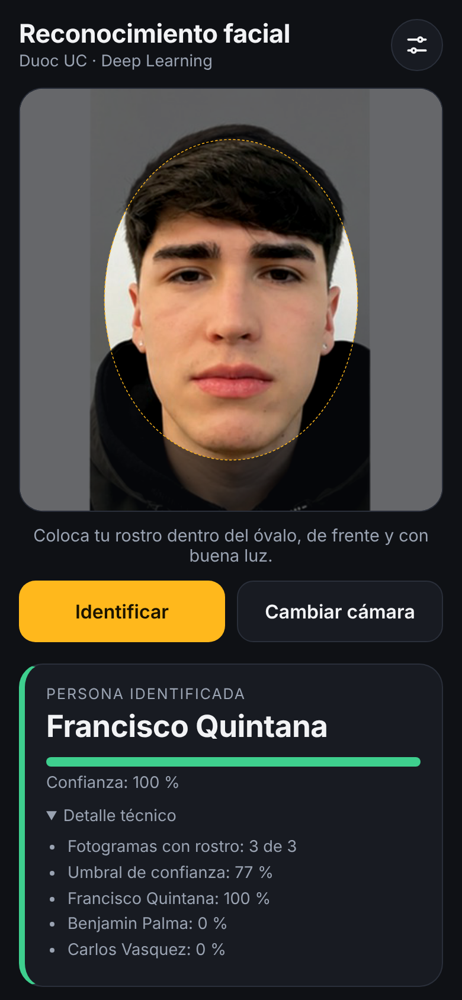
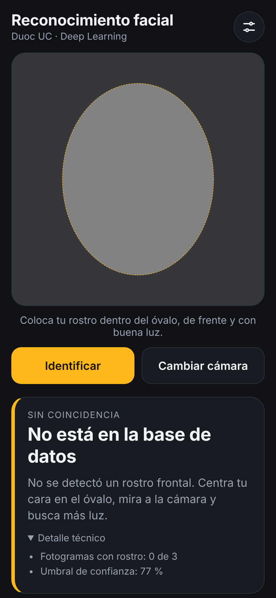

# App móvil — Reconocimiento Duoc (Capacitor)

Actualización local: la cámara ahora envía hasta 3 fotos JPEG completas a
`POST /predecir-fotos/`; la API aplica el recorte de entrenamiento antes de crear
la matriz 128×128×3. Requiere la API actualizada de esta entrega y volver a
sincronizar/compilar el APK. Ver [pasos de instalación](../../INSTALACION_INTEGRACION.md).
Las pruebas y capturas descritas abajo corresponden al flujo anterior de matrices.

Aplicación Android que toma una foto del rostro de una persona, la convierte en una
**matriz 128 × 128 × 3** y la envía a la API de reconocimiento. Muestra el **nombre** de
la persona o **"No está en la base de datos"**.

| Persona identificada | Sin coincidencia |
|---|---|
|  |  |

> Capturas generadas con una cámara simulada en Chromium (video de una foto del dataset), no en un teléfono físico.

## Tecnología

**App híbrida**: interfaz en HTML/CSS/JavaScript empaquetada como app nativa de Android con
[Capacitor](https://capacitorjs.com). Se instala como un `.apk` y se ejecuta sobre el WebView del sistema.
La cámara usa `getUserMedia` con vista previa en vivo, que permite la guía ovalada y capturar varios fotogramas.

## Estructura

| Archivo | Rol |
|---|---|
| `www/index.html`, `www/estilos.css` | Interfaz: visor cuadrado con óvalo guía, botones, tarjeta de resultado, ajustes. |
| `www/matriz.js` | **Conversión a matriz 128×128×3**: recorte cuadrado central → reducción en pasos → píxeles RGB. |
| `www/api.js` | Cliente HTTP de la API (tiempos límite y mensajes de error en español). |
| `www/app.js` | Lógica: cámara, captura de 3 fotogramas, llamada a la API, resultado. |
| `www/config.js` | URL de la API por defecto y parámetros de captura. |
| `android/` | Proyecto Android generado por Capacitor (permiso de cámara ya agregado en el manifiesto). |
| `.github/workflows/construir-apk.yml` | Compila el APK en la nube de GitHub. |
| `scripts/` | Pruebas (`probar_matriz.mjs`, `probar_e2e.py`) y servidor estático de desarrollo. |

## Flujo de datos

```
Cámara ──▶ cuadrado central del fotograma ──▶ 128×128 ──▶ matriz [128][128][3] (0-255)
   (3 fotogramas, 300 ms entre sí)                                 │
                                                                   ▼
Pantalla ◀── nombre | "No está en la base de datos" ◀── API  POST /predecir-lote/
```

1. El visor es **cuadrado**: lo que se ve es exactamente lo que se recorta.
2. La guía ovalada (60 % del ancho) reproduce el encuadre con el que se entrenó el modelo.
3. Cada fotograma se reduce en pasos de mitad para evitar dentado y se lee como píxeles RGB.
4. Se envían 3 matrices; la API exige rostro en al menos la mitad y **promedia** las probabilidades.
5. Si no hay cámara o se deniega el permiso, la app permite elegir una foto del dispositivo.

## Requisito: la API debe tener HTTPS

El teléfono debe alcanzar la API. Android bloquea por defecto las URL `http://`, y el navegador
del teléfono exige HTTPS para abrir la cámara. Opciones:

- **Túnel (más rápido para la demo):** con la API corriendo en un PC, `cloudflared tunnel --url http://localhost:8000` entrega una URL `https://…trycloudflare.com`. Solo funciona mientras ese PC esté encendido.
- **Despliegue en la nube:** en la raíz del proyecto hay un `Dockerfile` pensado para Hugging Face Spaces (puerto 7860). **No pudo probarse** en el entorno de desarrollo (sin acceso a Docker Hub); revísalo antes de depender de él.

La URL se escribe en **⚙ Ajustes → URL de la API** (con botón "Probar conexión") o se deja fija en `www/config.js`.

## Obtener el APK (sin Android Studio)

1. Crea un repositorio nuevo en GitHub y sube **el contenido de esta carpeta `app-movil`** como raíz del repositorio (debe quedar `package.json` en la raíz).
2. Entra a la pestaña **Actions** → **Construir APK** → **Run workflow** (también corre solo con cada push a `main`).
3. Al terminar (unos 5–10 min), abre la ejecución y descarga el artefacto **app-reconocimiento-duoc-apk** (un `.zip` con `app-debug.apk`).
4. Pasa el `.apk` al teléfono e instálalo (hay que permitir "instalar apps de orígenes desconocidos"). Al abrirla, acepta el permiso de cámara.

El APK es de tipo *debug* (firmado con la clave de depuración): es instalable y suficiente para la evaluación.

## Pruebas realizadas

| Prueba | Resultado |
|---|---|
| `npm run probar-matriz` — recorte y conversión a matriz, validación de forma y rango | 7/7 aprobadas |
| `python app-movil/scripts/probar_e2e.py` — Chromium + cámara simulada + API real | 4/5 escenarios (ver nota) |

Qué verifica la prueba de punta a punta: la app abre la cámara, captura 3 fotogramas, cada uno es una
matriz 128×128×3 de enteros 0-255, la API responde y la pantalla muestra el resultado. Sin errores de JavaScript.

**Nota sobre el 4/5:** la matriz que genera la app es prácticamente idéntica al recorte de entrenamiento
(comparación visual en `pruebas_e2e/`). El escenario que falla corresponde a una persona que el modelo ve con 57 %
de confianza, bajo el umbral de 77 %; es una limitación del modelo (ver README principal), no de la app.

### Lo que NO se pudo verificar

- **Compilación del APK** (entorno sin acceso a Gradle/Android SDK): el workflow de GitHub Actions es la vía prevista y no se ha ejecutado todavía.
- **Cámara real de un teléfono** y el permiso de cámara en Android.
- **Despliegue con Docker.**

Si la compilación falla, el log de la ejecución en GitHub Actions indica la causa.

## Desarrollo local

```bash
npm install
npm run probar-matriz          # pruebas unitarias de la conversión
npm run servir                 # app en http://localhost:5173 (la cámara funciona en localhost)
npx cap sync android           # copia www/ al proyecto Android
```

## Referencias

- Ionic. (s. f.). *Capacitor documentation*. https://capacitorjs.com/docs
- MDN Web Docs. (s. f.). *MediaDevices: getUserMedia() method*. https://developer.mozilla.org/en-US/docs/Web/API/MediaDevices/getUserMedia
- MDN Web Docs. (s. f.). *CanvasRenderingContext2D: getImageData() method*. https://developer.mozilla.org/en-US/docs/Web/API/CanvasRenderingContext2D/getImageData
